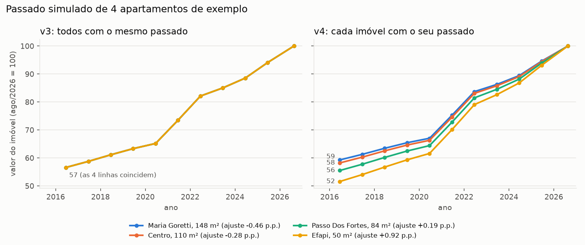

# 10. Versão 4 (experimento): passado simulado com lógica fuzzy

> **Situação:** experimento para comparar com a v3. O site e o artigo continuam na v3.

## 10.1 O que muda da v3 para a v4

Na v3, cada imóvel real ganha 10 linhas de passado (jun/2016 a jun/2025). O preço de cada
linha é o preço de ago/2026 dividido pelo quanto o índice IPCA+INCC subiu desde então.
Resultado: **todos os imóveis têm exatamente o mesmo passado em %**. Por exemplo, em 2016
qualquer imóvel valia 57% do valor de hoje.

Na v4, cada imóvel tem a **sua própria taxa de valorização**:

```
taxa do imóvel = taxa do índice IPCA+INCC (ano a ano) + ajuste fuzzy (pontos percentuais ao ano)

preço em jun/Y = preço de hoje ÷ (quanto o índice subiu de jun/Y até hoje × (1 + ajuste)^anos)
```

O ajuste é calculado por **lógica fuzzy**: regras escritas em linguagem comum, como "se
o bairro é barato e a tendência é de alta, a valorização fica muito acima do índice".
Em seguida, o ajuste é **centralizado por tipo**: tira-se a média, para que casas e
apartamentos, na média, continuem valorizando exatamente como o índice. A fuzzy **não
muda o quanto o mercado valorizou**; ela só **redistribui** a valorização entre os
imóveis.

Todo o resto é igual à v3, para a comparação ser justa:
- mesma base (3.283 casas e apartamentos) e mesmos preços levados a ago/2026;
- mesma divisão 80/20 por imóvel (semente 42) e mesma limpeza aprendida só no treino;
- mesmos candidatos e mesma validação cruzada agrupada por imóvel;
- erro medido só nos preços reais;
- mesmo critério de escolha (menor MdAPE; empate decidido pelo MAE).

As réguas da fuzzy (medianas de preço/m² e de área, tendência dos bairros) também saem
só dos imóveis de treino.

Arquivos: `scripts_predict/fuzzy_valorizacao.py` (regras e faixas, fáceis de editar),
`modelo_v4.py`, `resultados_v4.py`, `tabpfn_v4.py`, `comparar_v3_v4.py`. Saídas:
`dados/dataset_simulado_v4.csv`, `dados/resultados_modelos_v4.json`,
`dados/taxas_fuzzy_v4.json`, `dados/comparacao_v3_v4.json`, `dados/tabpfn_v4/` e
`docs/reports/modelo_v4.md`.

## 10.2 As regras fuzzy

### Entradas

| Entrada | Como é medida | Faixas (entre elas a passagem é gradual) |
|---|---|---|
| **Preço/m² do bairro** | mediana do bairro ÷ mediana do tipo (apartamento: R$ 7.606/m²; casa: R$ 5.995/m²). Bairro com menos de 10 imóveis fica com 1,00 | **barato** até 0,80 · **médio** de 0,95 a 1,05 · **caro** a partir de 1,20 |
| **Área do imóvel** | área ÷ área mediana do tipo (apartamento: 87 m²; casa: 200 m²) | **pequeno** até 0,60 · **médio** de 0,85 a 1,20 · **grande** a partir de 1,60 |
| **Tendência do bairro** | variação dos mesmos anúncios entre a 1ª e a última coleta (mar a ago/2026), em % ao ano. É puxada para zero quando há poucos anúncios (peso n ÷ (n + 20)); bairro com menos de 10 anúncios repetidos fica em 0 | **queda** até −2 · **estável** de −0,5 a +0,5 · **alta** a partir de +2 |
| **Tipo** | casa ou apartamento | cada tipo usa as próprias medianas e tem a própria centralização |

**Saída:** ajuste de −1,5 a +1,5 ponto percentual ao ano, em cinco níveis: muito abaixo
(−1,5), abaixo (−0,75), neutro (0), acima (+0,75) e muito acima (+1,5).

### Regras (definidas pela autora)

| # | Se… | Então o ajuste é… | Lógica econômica |
|---|---|---|---|
| 1 | bairro **barato** E tendência **alta** | muito acima | ainda há espaço para subir e o mercado confirma |
| 2 | bairro **barato** E tendência **estável** | acima | quem não alcança os bairros caros procura os mais baratos |
| 3 | bairro **barato** E tendência **queda** | neutro | as duas forças se anulam |
| 4 | bairro **médio** E tendência **alta** | acima | |
| 5 | bairro **médio** E tendência **estável** | neutro | |
| 6 | bairro **médio** E tendência **queda** | abaixo | |
| 7 | bairro **caro** E tendência **alta** | neutro | bairro consolidado, mas com procura |
| 8 | bairro **caro** E tendência **estável** | abaixo | já está perto do "teto" |
| 9 | bairro **caro** E tendência **queda** | muito abaixo | |
| 10 | imóvel **pequeno** | acima | mais compradores (primeiro imóvel, investidor, aluguel) |
| 11 | imóvel **médio** | neutro | |
| 12 | imóvel **grande** | abaixo | menos compradores |

### Como a fuzzy decide (método de Mamdani)

1. **Fuzzificação:** cada entrada vira **graus de pertinência** de 0 a 1. Um bairro não
   precisa ser "barato" ou "médio"; ele pode ser um pouco de cada.
2. **Força de cada regra:** quando a regra tem duas condições ligadas por E, vale o menor
   dos dois graus.
3. **Agregação:** cada nível de saída é "cortado" na força da sua regra, e as formas
   cortadas são sobrepostas.
4. **Defuzzificação pelo centroide:** o ajuste é o ponto de equilíbrio (centro de massa)
   da forma final.
5. **Centralização:** do ajuste de cada imóvel se tira a média do tipo.

### Exemplo passo a passo: apartamento de 110 m² no Centro

| Passo | Cálculo | Resultado |
|---|---|---|
| Entradas | preço/m² do Centro ÷ apartamentos = **1,12**; área 110 ÷ 87 = **1,27**; tendência do Centro: +0,12% ao ano, já puxada para zero | |
| Graus do bairro | 1,12 fica entre "médio" (termina em 1,20) e "caro" (começa em 1,05) | médio **0,5**, caro **0,5** |
| Graus da área | 1,27 já passou de 1,20, onde "médio" começa a cair | médio **0,83**, grande **0,17** |
| Grau da tendência | +0,12 fica dentro de "estável" | estável **1,0** |
| Regras acionadas | 5 (médio E estável → neutro): força min(0,5; 1,0) = **0,5** · 8 (caro E estável → abaixo): **0,5** · 11 (área média → neutro): **0,83** · 12 (área grande → abaixo): **0,17** | |
| Centroide | metade da força puxa para "abaixo" (−0,75) e o resto para "neutro" (0) | **−0,32 p.p./ano** |
| Centralização | a média do ajuste dos apartamentos era −0,04, então −0,32 − (−0,04) | **−0,28 p.p./ano** |
| Taxa do imóvel | 5,80% (média do índice em 10 anos) − 0,28 | **≈ 5,52% ao ano** |
| Passado | em jun/2016 valia **58%** do valor de hoje (na v3, 57%) | |

Para comparar, um apartamento de 50 m² na Efapi (bairro barato, com tendência de alta e
área pequena) aciona as regras 1 e 10 com força total. O ajuste fica em **+0,92 p.p./ano**,
e em 2016 ele valia **52%** do valor de hoje.

## 10.3 Distribuição das taxas por imóvel (v4) × taxa única (v3)

Taxa = média do índice em 10 anos (**5,80% ao ano**, a mesma para todos na v3) + ajuste
fuzzy.

| Tipo | v3 | v4 mínimo | v4 p10 | v4 mediana | v4 média | v4 p90 | v4 máximo |
|---|---:|---:|---:|---:|---:|---:|---:|
| Apartamento (1.896) | 5,80% | 5,34% | 5,40% | 5,61% | **5,80%** | 6,29% | 6,71% |
| Casa (1.387) | 5,80% | 5,00% | 5,38% | 5,75% | **5,80%** | 6,18% | 6,62% |

A média continua em 5,80%, como pedia a centralização. A mediana do apartamento fica
abaixo da média porque muitos apartamentos estão no Centro, que é um bairro mais caro.

**Por bairro** (mediana da taxa; bairros com 10 ou mais imóveis):

| Apartamento | Taxa | | Casa | Taxa |
|---|---:|---|---|---:|
| Maria Goretti | 5,45% | | Jardim Itália | 5,00% |
| Centro | 5,45% | | Jardim Europa | 5,21% |
| Jardim Itália | 5,56% | | Esplanada | 5,38% |
| Presidente Médici | 5,59% | | Universitário | 5,40% |
| Passo dos Fortes | 6,08% | | Centro | 5,58% |
| Paraíso | 6,18% | | Efapi | 6,15% |
| Santo Antônio | 6,51% | | Desbravador | 6,22% |
| Pinheirinho | 6,62% | | Araras | 6,28% |
| Efapi | 6,71% | | Pinheirinho | 6,37% |

A lista completa está em `dados/taxas_fuzzy_v4.json`.

**Observação:** o centroide junta várias regras ao mesmo tempo e puxa o resultado para o
meio. Por isso, embora a saída vá de −1,5 a +1,5, os ajustes reais ficaram entre −0,80 e
+0,92 (80% dos imóveis entre −0,4 e +0,5). Se a autora quiser extremos maiores, dá para
esticar a escala depois do centroide, mantendo a média zero.



*Figura: passado simulado de 4 apartamentos na v3 (as quatro linhas coincidem) e na v4.
Os degraus de 2021 e 2022 aparecem nas duas versões, porque vêm do índice real; a fuzzy
só muda a inclinação de cada imóvel.*

## 10.4 Resultados dos modelos

### O que esperar antes de olhar os números

O erro é medido **só nos preços reais de hoje**, e esses preços são **idênticos** na v3 e
na v4. O que muda é só o passado simulado usado no treino. Por isso, as métricas deveriam
ficar quase iguais, e ficaram.

### Lado a lado (modelo escolhido; teste com preços reais)

| Tipo | Modelo | Versão | MdAPE CV | MdAPE teste | MAE | RMSE | R² |
|---|---|---|---:|---:|---:|---:|---:|
| Apartamento | ★ Ensemble (Random Forest preço e log, XGBoost log) | v3 | 12,9% | 13,1% | R$ 123.858 | R$ 176.736 | 0,781 |
| Apartamento | ★ Ensemble (Random Forest preço e log, XGBoost log) | v4 | 12,7% | 12,8% | R$ 123.631 | R$ 177.385 | 0,779 |
| Casa | ★ TabPFN 3.5 (API) | v3 | 19,2% | 18,7% | R$ 302.336 | R$ 449.895 | 0,540 |
| Casa | ★ TabPFN 3.5 (API) | v4 | 19,1% | 18,6% | R$ 302.404 | R$ 449.918 | 0,540 |
| Casa | reserva: Ensemble (Random Forest, CatBoost, XGBoost; preço) | v3 | 19,6% | 18,9% | R$ 300.285 | R$ 440.927 | 0,558 |
| Casa | reserva: Ensemble (XGBoost, Gradient Boosting, Random Forest; preço) | v4 | 19,5% | 18,6% | R$ 302.996 | R$ 444.900 | 0,550 |

Os modelos escolhidos são os mesmos nas duas versões. Só a reserva das casas trocou o
CatBoost pelo Gradient Boosting.

**A diferença é real?** Fiz um teste de reamostragem (bootstrap pareado, 2.000 sorteios
dos imóveis de teste):

| Tipo | Modelo | MdAPE v4 − v3 | Intervalo de 95% | Imóveis em que a v4 erra menos |
|---|---|---:|---|---:|
| Apartamento | Ensemble | −0,31 p.p. | −0,81 a +0,24 | 48% |
| Apartamento | Random Forest (preço) | −0,06 p.p. | −0,55 a +0,85 | 45% |
| Casa | TabPFN 3.5 (API) | −0,14 p.p. | −0,86 a +0,54 | 50% |
| Casa | Random Forest (preço) | +0,17 p.p. | −1,09 a +1,47 | 49% |

Todos os intervalos passam pelo zero, e a v4 acerta melhor em cerca de metade dos
imóveis. **Conclusão: a v4 não erra menos nem mais que a v3 no preço de hoje; a diferença
é ruído.**

### Ranking completo da v4 (posição pela validação cruzada)

<!-- RANKING_V4 -->

## 10.5 O passado que o modelo aprendeu

Esta medida mostra se o modelo realmente aprendeu passados diferentes. Para cada imóvel
real, perguntei ao modelo do site quanto ele valia em jun/2016 e calculei a taxa anual
até hoje. Não é medida de acerto.

| Tipo | Versão | p10 | Mediana | p90 | Desvio-padrão |
|---|---|---:|---:|---:|---:|
| Apartamento | v3 | 5,23% | 5,57% | 5,84% | 0,26 p.p. |
| Apartamento | v4 | 4,95% | 5,42% | 6,21% | 0,50 p.p. |
| Casa | v3 | 4,84% | 5,58% | 6,48% | — |
| Casa | v4 | 4,64% | 5,58% | 6,51% | — |

- **Apartamentos:** a faixa entre p10 e p90 dobrou (de 0,6 para 1,3 ponto), ou seja, o
  modelo aprendeu a variação que a fuzzy colocou nos dados.
- **Casas:** quase nada mudou. O modelo das casas já variava bastante na v3, e essa
  variação não vem do índice: vem da dificuldade de prever casas, que têm erro maior.
  O desvio-padrão das casas não é mostrado porque poucas casas com preços estranhos na
  base o distorcem.
- **v3:** mesmo com o passado idêntico nos dados, o modelo já varia um pouco (0,26 ponto),
  porque as árvores não reproduzem o índice com perfeição.

## 10.6 Valorização projetada (próximos anos)

A projeção da v3 combina a taxa medida nos anúncios (peso de 29%) com o índice IPCA+INCC
(71%) (seção 9.5). Na v4, o índice de cada imóvel passa a ser o índice + ajuste fuzzy:

```
taxa projetada v4 do imóvel = taxa projetada v3 do bairro + 0,71 × ajuste fuzzy do imóvel
```

A faixa pessimista–otimista se desloca do mesmo tanto.

| Tipo | v3 (média do tipo) | v3 por imóvel (bairro), p10–p90 | v4 por imóvel, p10–p90 | v4 mínimo–máximo |
|---|---|---|---|---|
| Apartamento, central | **+4,33%** | +4,12% a +4,64% | +3,98% a +4,88% | +3,67% a +6,03% |
| Apartamento, pessimista | +2,64% | | +2,18% a +2,93% | |
| Apartamento, otimista | +8,32% | | +8,00% a +9,28% | |
| Casa, central | **+4,17%** | +3,87% a +4,60% | +3,77% a +4,81% | +2,82% a +5,31% |
| Casa, pessimista | +2,47% | | +1,85% a +2,86% | |
| Casa, otimista | +8,17% | | +7,87% a +9,12% | |

- **Na média de cada tipo, a v4 projeta o mesmo que a v3** (+4,33% e +4,17% ao ano),
  porque o ajuste fuzzy tem média zero.
- **Por imóvel, a v4 espalha mais:** o apartamento de 50 m² na Efapi passa de +4,64% para
  +5,29% ao ano; o de 110 m² no Centro passa de +4,26% para +4,06%.
- **Cuidado com a dupla contagem:** a tendência dos anúncios já entra nos 29% da v3 e
  entra de novo na fuzzy. O efeito é pequeno, porque a tendência foi puxada para zero,
  mas a banca pode perguntar.

## 10.7 Recomendação: o que levar para o artigo

**Recomendo manter a v3 como modelo principal e citar a v4 só como experimento**, em um
parágrafo ou uma tabela curta (análise de sensibilidade), ou nem citar, se faltar espaço.

Por quê:
1. **A v4 não erra menos.** No preço de hoje, a diferença é ruído (seção 10.4). Trocar de
   versão não melhora o resultado principal do trabalho.
2. **A v4 deixa o passado mais variado, mas não mais certo.** Não há preços reais de
   venda de 2016 a 2025 para conferir se, por exemplo, a Efapi valorizou mais que o
   Centro. As regras são uma hipótese razoável, mas continuam sendo hipótese.
3. **A v4 acrescenta escolhas que precisam ser defendidas.** Faixas, regras e "bairro
   barato valoriza mais" podem ser defendidos com lógica econômica, mas não com dados.
   A literatura tem exemplos dos dois lados: bairros periféricos que crescem mais e
   bairros nobres que valorizam mais.
4. **A tendência é a entrada mais frágil.** Vem de 5 meses de anúncios, em que 96% dos
   preços não mudaram, e foi usada para desenhar 10 anos de passado.
5. **A v3 é mais simples de explicar:** um índice oficial aplicado igual para todos.

Onde a v4 ajuda: mostra que o trabalho **testou a hipótese de valorização igual para
todos** e que o resultado principal (o preço de hoje) **não depende dela**. Isso é uma
análise de robustez, e é um bom argumento.

### O que a banca provavelmente vai perguntar

| Pergunta | Resposta sugerida |
|---|---|
| "De onde vêm as regras?" | "São regras que eu defini com lógica econômica (procura por imóveis menores, espaço de crescimento dos bairros mais baratos, tendência dos anúncios). Não foram aprendidas dos dados, porque não há preço de venda histórico por imóvel." |
| "Como sabe que estão certas?" | "Não sei, e por isso a v4 ficou como experimento. O erro foi medido só nos preços reais, e a v4 não mudou esse erro. Para validar as regras, seriam necessários dados de venda ao longo dos anos." |
| "Por que fuzzy e não um número fixo por bairro?" | "Porque as fronteiras não são nítidas: um bairro com preço/m² 12% acima da média é um pouco médio e um pouco caro. A fuzzy faz a passagem gradual e deixa as regras legíveis." |
| "A fuzzy não muda a valorização média?" | "Não. O ajuste é centralizado por tipo, então na média tudo continua igual ao índice IPCA+INCC. A fuzzy só redistribui a valorização entre os imóveis." |
| "Se o resultado é igual, para que serve?" | "Para mostrar que a conclusão não depende da hipótese de que todos os imóveis valorizaram igual. Mudei o passado e o erro de hoje continuou o mesmo." |
| "A tendência de 5 meses vale para 10 anos?" | "É a parte mais frágil, e por isso ela foi puxada para zero nos bairros com poucos anúncios. Sem dados mais longos, ela só serve como indicação." |

## 10.8 Como reproduzir

```bash
make tabpfn-v4        # TabPFN 3.5 pela API (TABPFN_TOKEN) e local, com corte de 60 min (horas)
make modelo-v4        # dataset v4 + modelo escolhido + docs/reports/modelo_v4.md
make resultados-v4    # todos os candidatos (dados/resultados_modelos_v4.json)
make comparar-v3-v4   # taxas, projeção, passado aprendido e figura (dados/comparacao_v3_v4.json)
python scripts_predict/fuzzy_valorizacao.py   # mostra um exemplo das regras
```

Os modelos da v4 (`modelos/preco_imovel_modelo_v4.pkl` e `modelos/v4/`) ficam só no
computador, porque não vão para o site.
